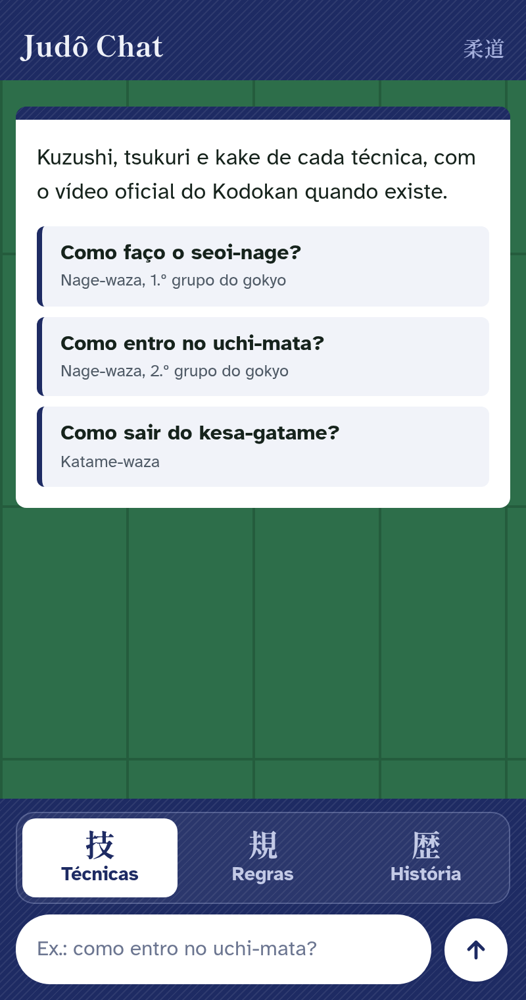

# Judô Chat

Assistente que responde em português do Brasil a perguntas sobre técnicas, regras e história
do judô, e recusa qualquer outro assunto. Está no ar em
https://felipe-nr.github.io/judoka-assistant/.



## Por que existe

Pratico judô, e no meu dojô a sensei Duda precisava procurar à mão o nome de uma técnica numa
tabela de mais de 40 páginas, onde muitos nomes são parecidos, e depois buscar no YouTube um
vídeo com a aplicação correta.

O problema é comum: no Brasil, muita técnica é conhecida por um nome popular, às vezes usado de
forma errada há anos ("ashi barai", "morote seoi-nage", "mata-leão"), e as fontes abertas sobre
técnicas, como a API da IJF e as listas de vídeos, não trazem texto em português. O assistente
responde em pt-BR a partir do Curso de Waza da Federação Gaúcha de Judô (FGJ), usa o nome
oficial do Kodokan e avisa quando a pergunta usou um nome popular. Diante de um nome ambíguo,
ele apresenta as técnicas candidatas em vez de escolher uma em silêncio. Cada técnica citada
vem com o vídeo do Kodokan, o kanji e a pronúncia.

Como projeto de portfólio, comparei três abordagens (o corpus inteiro no contexto com cache,
RAG com busca híbrida e RAG agentic) e fiquei com a primeira, o CAG. A comparação está em
[`docs/historico/`](docs/historico/propostas-iniciais.md) e a decisão, no
[ADR 0001](docs/decisoes/0001-manter-cag.md).

## Como funciona


1. O reconhecedor acha na pergunta os nomes de técnica (oficial, da IJF, grafias variadas e
   nomes populares) e os termos de regras, sem chamar modelo.
2. O guardrail classifica a pergunta em técnica, história, regras ou fora do escopo. Qualquer
   erro bloqueia a resposta.
3. O modelo de resposta recebe o corpus inteiro num prefixo em cache (CAG) e, depois do corte
   do cache, o histórico, a pergunta e as fichas das técnicas reconhecidas.
4. Vídeos, kanji e pronúncia saem dos dados, sem modelo.

Os quatro diagramas e os componentes estão em [`docs/arquitetura/`](docs/arquitetura/README.md).

## Números

| Medida | Resultado |
|-|-|
| Avaliação com 164 perguntas (2026-10-23) | 0 falso-aceite adversarial, 100% de recusa correta, 0% de falsa recusa |
| Custo por pergunta na produção (2026-10-28) | ~US$ 0,0004 com o cache quente; ~US$ 0,007 quando grava o prefixo |
| Latência do guardrail | ~0,4 s de mediana pela Decisions API, contra ~4 s antes |
| Corpus no prompt | ~28 mil tokens: 104 técnicas, nomes populares, regras, história e faixas |

## Decisões de engenharia

- **CAG em vez de RAG.** O corpus ocupa cerca de 10% da faixa de contexto que o gpt-6-luna
  cobra pelo preço menor, então vai inteiro num prefixo em cache, sem índice nem embeddings. O
  [ADR 0001](docs/decisoes/0001-manter-cag.md) diz quando isso deixa de valer e o que vem antes
  de um RAG.
- **Guardrail que falha fechado.** A Decisions API devolve probabilidades em vez de texto e
  pergunta também se o pedido é de agressão ou tenta mudar as instruções. Os termos de regras
  reconhecidos vão junto, o que zerou as falsas recusas
  ([arquitetura](docs/arquitetura/README.md)).
- **Custo medido nos logs.** O prefixo fica 12 horas em cache. Com pouco tráfego, as gravações
  do prefixo são a maior parte do gasto, e `scripts/custo_openai.py` mede isso a partir do
  journal da VM ([custos](docs/operacao/custos.md)).
- **API pública com gasto limitado.** Rate limit por IP e total, bloqueio por país e uvicorn só
  em `127.0.0.1`, atrás do Tailscale Funnel ([produção](docs/operacao/deploy.md)).
- **Deploy sem porta aberta.** O GitHub Actions entra na tailnet como nó efêmero e chama por
  SSH um comando forçado que só instala commits do `main`.
- **Dados curados e versionados.** O texto da FGJ entra sem edição, os nomes populares são
  entidades próprias, e o build do glossário falha quando um nome fica sem destino
  ([dados](docs/dados.md)). O que depende de fonte externa está em
  [`docs/validacoes-externas.md`](docs/validacoes-externas.md).

## Stack

Python 3.12+ com FastAPI, Pydantic e uv. Na produção, OpenAI (gpt-6-luna pela Responses API e
pela Decisions API); a Anthropic (Haiku 5.5) é a alternativa. Página estática no GitHub Pages,
API numa VM Always Free da OCI com systemd e Tailscale Funnel, CI e deploy no GitHub Actions.

## Rodar

```bash
uv sync
cp .env.example .env   # preencha ANTHROPIC_API_KEY
uv run uvicorn judo_chat.main:app --reload
```

A página de chat fica em http://localhost:8000 e a API em `POST /api/perguntar`
(`{"query": "como faço o ashi barai?"}`). Para usar a OpenAI e os outros ajustes, veja
[`docs/configuracao.md`](docs/configuracao.md).

## Testes

```bash
uv run pytest            # sem rede: reconhecedor, corpus, guardrail com fakes, API
uv run pytest -m eval    # chama a API de verdade (custa dinheiro) e grava tests/eval/report.json
uv run ruff check . && uv run ruff format --check .
```

## Documentação

| Documento | Conteúdo |
|-|-|
| [`docs/arquitetura/`](docs/arquitetura/README.md) | Diagramas, componentes, guardrail, prompt e cache, avaliação |
| [`docs/decisoes/`](docs/decisoes/0001-manter-cag.md) | Decisões e as condições para revê-las |
| [`docs/operacao/deploy.md`](docs/operacao/deploy.md) | Página, VM, deploy automático, proteções da API, bloqueio por país |
| [`docs/operacao/custos.md`](docs/operacao/custos.md) | Custo medido por provedor, re-aquecimento do cache, como medir de novo |
| [`docs/configuracao.md`](docs/configuracao.md) | Provedor, modelos, TTL do cache, limites do guardrail |
| [`docs/dados.md`](docs/dados.md) | Arquivos de dados, o que editar, build do glossário, importação da FGJ |
| [`docs/validacoes-externas.md`](docs/validacoes-externas.md) | O que falta confirmar com fontes externas |
| [`docs/roadmap.md`](docs/roadmap.md) | Trabalho identificado e ainda não feito |
| [`docs/historico/`](docs/historico/propostas-iniciais.md) | As propostas avaliadas no início (RAG e RAG agentic) |
| [`docs/guia-estilo-ptbr.md`](docs/guia-estilo-ptbr.md) | Estilo dos textos em pt-BR |
| [`docs/prototipos/`](docs/prototipos/README.md) | Protótipos da página |
