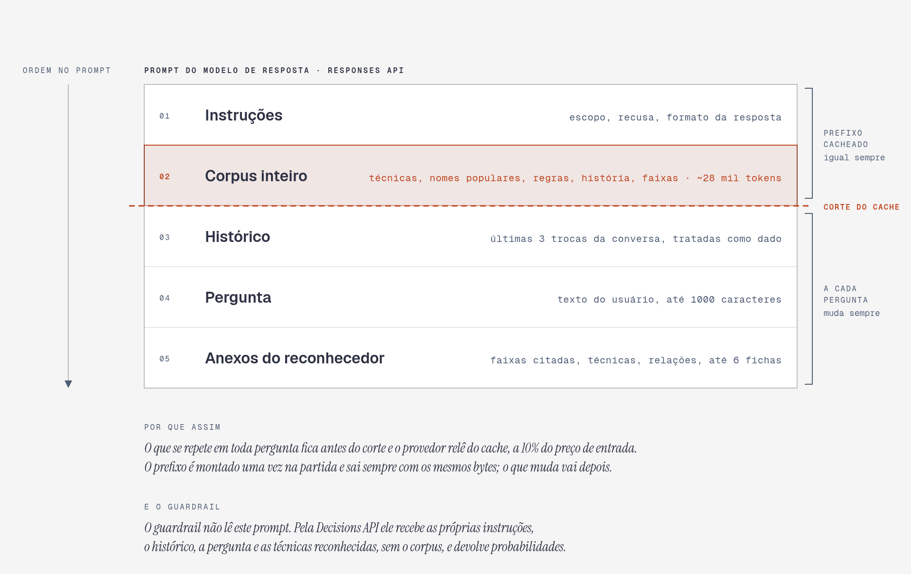
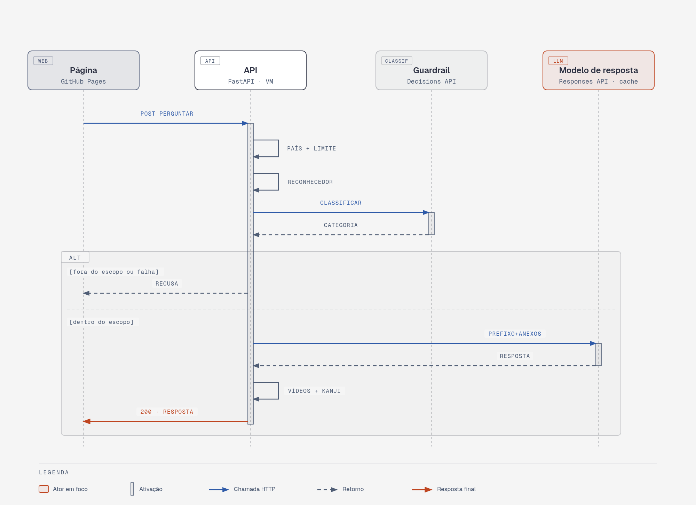
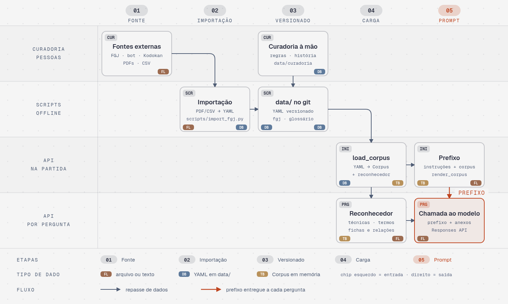
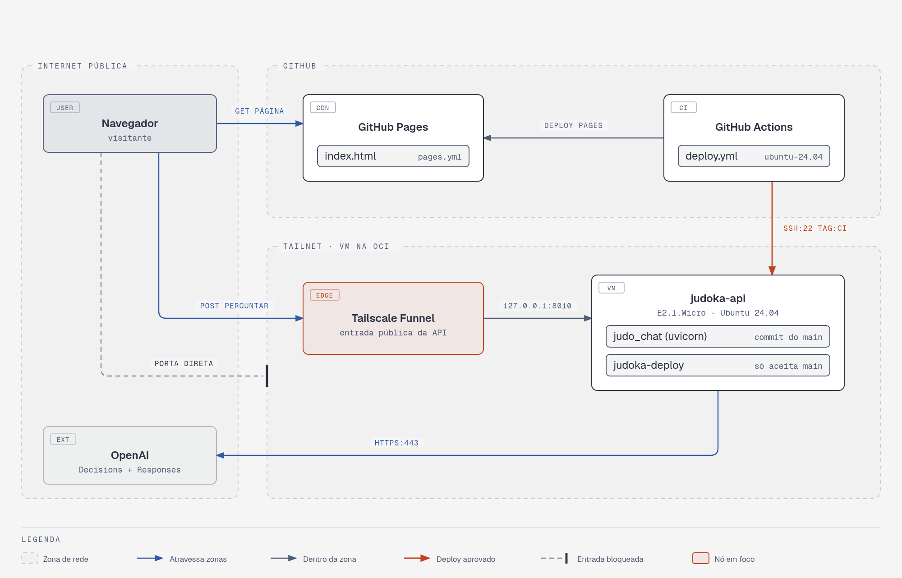

# Arquitetura

Diagramas da arquitetura CAG (o corpus inteiro no contexto, com cache de prompt). Cada
diagrama tem uma página HTML com SVG embutido, que é a fonte, e um PNG
exportado dela para aparecer aqui no GitHub.

## Anatomia do prompt

As partes do prompt do modelo de resposta e onde fica o corte do cache. O guardrail recebe
outro prompt, sem o corpus.



## Uma pergunta, ponta a ponta

Uma pergunta da página até a resposta, com as duas chamadas ao provedor: o guardrail, um
classificador pela Decisions API, e o modelo de resposta, que gera o texto pela Responses API.



## Do dado ao prefixo

Das fontes e da curadoria até o prefixo e o reconhecedor.



## Onde roda

Onde cada parte roda, a entrada pública e o caminho do deploy.



## Atualizar

Os HTML são gerados por `scripts/diagramas_arquitetura.py`, no estilo da skill
diagram-design com a skin padrão. Não edite o HTML à mão: mude o script e gere de novo.

```bash
uv run python scripts/diagramas_arquitetura.py docs/arquitetura
```

Depois exporte os PNG com o `export_png.py` da skill, em escala 2, um por diagrama:

```bash
python3 <skill>/scripts/export_png.py docs/arquitetura/prompt-cag.html docs/arquitetura/prompt-cag.png 2
```

Confira o resultado com os verificadores da skill (`self_check.py` e `verify-geometry.py`)
e olhe cada PNG.
